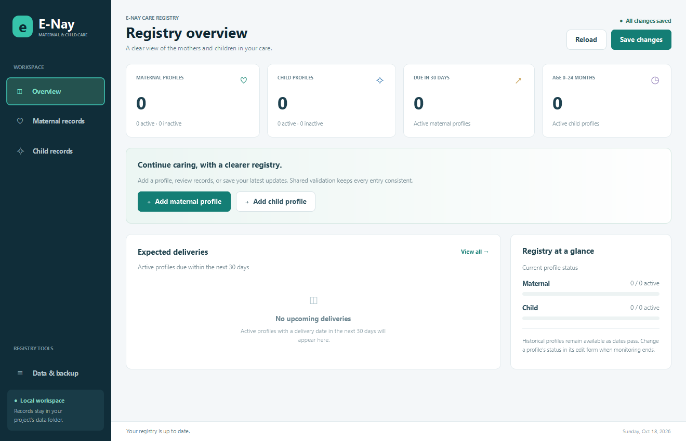

# E-Nay

E-Nay is an offline Java application for managing maternal and child health records in rural communities. The project supports SDG 3 (Good Health and Well-being) and SDG 10 (Reduced Inequalities).

## Website and mobile workspace

The new [browser edition](web/README.md) has an inviting website with real licensed photography and an installable, responsive PWA. It provides maternal/child profiles, visits and food/symptom notes, patient vaccination requests, staff approval with stock reservations, and staff-recorded administered doses, child measurements and charts, vaccine inventory, cached guides, and reviewed backup/import flows. Separate patient/staff accounts share clinic records through Cloudflare, with encrypted authorized offline copies. Sign in online first and wait for **Offline ready** and confirmation of a device copy.

With Node.js 24+, run `node web/server/dev-server.mjs` from this folder, then open `http://127.0.0.1:8765/`. A phone uses the deployed HTTPS site and its browser's installation menu.

Cloud clinic records and encrypted browser copies are separate from Java's `data/` folder. Staff can explicitly import Java profiles and reviewed legacy device data; no existing records are uploaded automatically. The [web documentation](web/README.md) explains offline setup, security limits, compatibility, and proposal features that still require clinical specification. No AI-generated photographs are included.

## Desktop app

The JavaFX interface provides an overview dashboard, maternal and child registries, search/status filters, record details, validated add/edit forms, active/inactive status, local backup export, and storage diagnostics.



On Windows, install a **64-bit JDK 17 or later**, extract/clone the project into a writable folder, and double-click **`run-desktop.bat`**. The first setup downloads checksum-verified JavaFX libraries; subsequent starts use the cache and work offline. Maven and Python are not needed to run the desktop app.

On Linux/macOS, use `sh scripts/desktop.sh`. See [desktop setup](docs/DESKTOP.md) for platform requirements, offline caching, Maven/IDE support, build-only commands, and GUI tests.

Adding or editing a profile saves automatically after validation. Failed saves keep the change in memory with a visible unsaved warning. Use **Save changes** to retry, **Reload** to read repaired/external files, and **Data & backup** to export a ZIP of the saved records. Export never rewrites the source files. Existing IDs stay fixed; use status Inactive when monitoring ends. Historical dates may remain unchanged during an edit.

## Console app

The original seven-option console remains available with no external Java libraries:

- Windows: double-click `run.bat` or run `./run.ps1`.
- Linux/macOS:

```sh
mkdir -p out
find src -name '*.java' ! -path '*/desktop/*' > /tmp/enay-sources.txt
javac -encoding UTF-8 -d out @/tmp/enay-sources.txt
java -cp out enay.Main
```

Launch from the project root. There are no login credentials or sample patient records. Both interfaces share `data/` and the process lock, so close one before opening the other. Console options 1–2 add, 3–4 display, 5 saves, 6 reloads, and 7 exits. The console still requires an explicit save; closing the terminal does not save automatically.

## MVC structure

```text
src/enay/
  Main.java                         Console startup and process lock
  desktop/                          JavaFX view, controller, app and CSS
  service/                          Byte-preserving ZIP backup export
  model/                            MaternalProfile and ChildProfile
  view/                             RecordView interface and ConsoleView
  controller/                       RecordController
  repository/                       RecordRepository and FileRecordRepository
  validation/                       Shared ValidationUtils
  exception/                        InvalidRecordException
tests/                              Validation, recovery, and console scenarios
docs/                               Architecture and documentation
data/                               Local records (excluded from Git)
```

The **model** encapsulates record fields and validation. The **view** owns prompts and presentation. The **controller** coordinates user actions through `RecordView` and `RecordRepository`. The repository owns in-memory collections and file persistence and returns diagnostic messages for the controller to pass to the view. `Main` creates and connects these objects.

The console controller uses the synchronous RecordView interface. The desktop has an event-driven DesktopView.Actions boundary and a single background storage executor. Its controller calls the same repository interface; widgets never read/write files. All scene changes happen on the JavaFX application thread. Shutdown finishes accepted storage work before releasing the data lock.

Read [the architecture guide](docs/ARCHITECTURE.md) and [the team workflow](CONTRIBUTING.md) before changing shared interfaces.

## Record rules

- Maternal IDs: `M` plus exactly three digits; child IDs: `C` plus exactly three digits. IDs are normalized to uppercase and must be unique within their record type.
- Maternal age: integer from 12 through 60, inclusive.
- Names: Unicode letters and attached accents, spaces, hyphens, apostrophes, and periods. Preserve entered capitalization and normalize whitespace. Digits, pipes, and line breaks are rejected.
- Dates: real `YYYY-MM-DD` dates, year 0001 or later. A new delivery date must be today or later. A new child's birth date must be within the last two years, inclusive, and cannot be future.
- Historical records remain loadable after their delivery date passes or the child ages beyond the new-registration window.
- Status: `Active` / `Inactive`; gender: `Male` / `Female`, accepted without case.
- Capacity: 100 maternal and 100 child records.

## Local storage

UTF-8 text files hold one pipe-delimited record per line:

```text
maternal_records.txt: profileId|motherName|age|expectedDeliveryDate|status
child_records.txt:   childId|childName|gender|dateOfBirth|motherName|status
```

`data/system_data.dat` holds two four-byte Java integers: maternal count, then child count. Text rows determine actual loaded counts. The data-folder lock prevents simultaneous E-Nay processes from using the same folder. Fingerprints detect external text-file changes before saving. Save All stages all files before replacement and attempts rollback on ordinary I/O failure. Multi-file saves are not guaranteed atomic across process termination or power loss.

Missing files preserve current memory. Malformed rows are reported and skipped; a permitted later save writes accepted rows only. Unreadable, entirely malformed, or over-capacity files block saving. Reload deliberately after repairing files or accepting external changes. Keep backups of important records.

Live records, `.enay.lock`, temporary files, and backups are excluded by `.gitignore`. The repository contains no patient data.

## Verify

With Python 3 and JDK 17+:

```sh
python tests/run_tests.py
```

Core tests create disposable directories. JavaFX screens are tested separately after building:

```sh
python tests/run_desktop_tests.py --module-path .javafx/17.0.18/win
```

On Linux CI use `xvfb-run -a` and the `linux` module directory. Desktop tests drive actual JavaFX forms, filtering, edits, auto-save, failed saves, backup preservation, reload confirmation, shutdown ordering and compact layout.

The core tests cover field normalization, boundaries, historical records, malformed files, save rollback, unsaved-change prompts, concurrent process locking, external modifications, and a save/reload across separate JVMs. See [TEST_RESULTS.txt](TEST_RESULTS.txt) for the recorded run.
