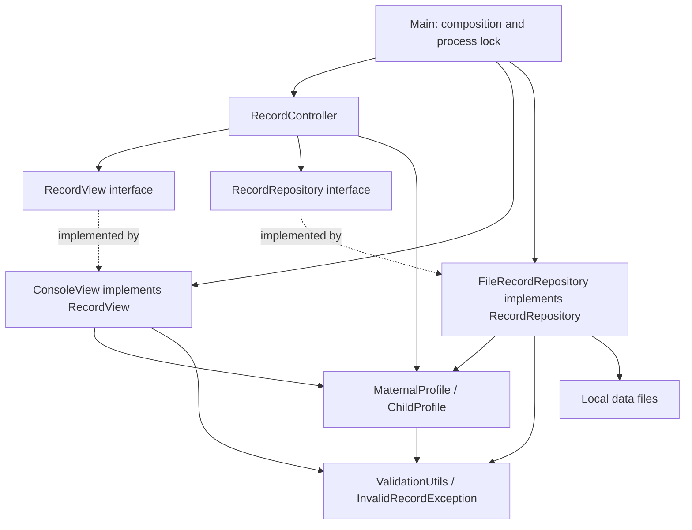

# E-Nay architecture

## Model

`MaternalProfile` and `ChildProfile` have private fields and getters, validated constructors, text parsers, and storage formatting. `ValidationUtils` normalizes IDs, names, dates, ages, and allowed values. Constructors enforce validity for loaded records; new-registration date eligibility is also enforced by repository add methods.

`RecordRepository` is the model/data boundary for the controller. Its file implementation owns two arrays of capacity 100, duplicate checks, dirty flags, safe-load flags, and source fingerprints. It returns immutable list snapshots, so callers cannot change its collections. Separate repository instances have separate state.

## View

`RecordView` describes the interactions the current controller needs. `ConsoleView` reads from an injected `Scanner` and writes to an injected `PrintStream`. It owns the seven-option menu, field prompts, validation feedback, record lists, and confirmations. It has no file access.

## Controller

`RecordController` depends on `RecordView` and `RecordRepository`, supplied through its constructor. It loads records at startup, dispatches menu actions, checks unique IDs, constructs profiles after field collection, requests saves and reloads, and coordinates unsaved-change confirmation. It has no console or file API calls. Replacing the console with an event-driven GUI will require adapting the current synchronous interaction flow.

## Persistence and startup

`FileRecordRepository` retains the original UTF-8 pipe-delimited formats and binary counts. It reports messages through `drainMessages()`, which the controller passes to the view. A missing file preserves memory; malformed rows are skipped; all-invalid, unreadable, and over-capacity sources block saving. File fingerprints reject unexpected external changes. Save All stages closed replacement files, retains backups during replacement, and attempts rollback after ordinary I/O failures.

`Main` resolves the data directory, obtains the process lock, constructs the repository/view/controller, and runs the controller. Launch from the repository root or its `src` folder to use the same `data` folder. The persistent lock filename may remain after exit; the OS releases the lock. No database, login, Swing interface, background worker, clinical classifier, or crash-safe multi-file transaction is implemented.

## Data dictionary

| Class | Field | Java type | Rule |
| --- | --- | --- | --- |
| MaternalProfile | profileId | String | M plus exactly 3 digits; unique maternal ID |
| MaternalProfile | motherName | String | Required validated name |
| MaternalProfile | age | int | 12–60 inclusive |
| MaternalProfile | expectedDeliveryDate | String | YYYY-MM-DD; today or later for new registration |
| MaternalProfile | status | String | Active / Inactive |
| ChildProfile | childId | String | C plus exactly 3 digits; unique child ID |
| ChildProfile | childName | String | Required validated name |
| ChildProfile | gender | String | Male / Female |
| ChildProfile | dateOfBirth | String | YYYY-MM-DD; not future; within two years for new registration |
| ChildProfile | motherName | String | Required validated name; no foreign-key link |
| ChildProfile | status | String | Active / Inactive |
| FileRecordRepository | maternalCount | int | Generated 0–100 |
| FileRecordRepository | childCount | int | Generated 0–100 |
